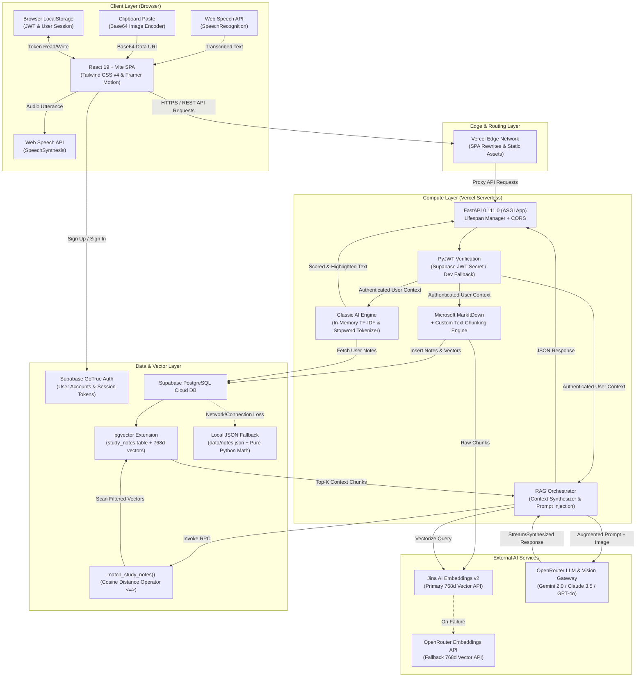
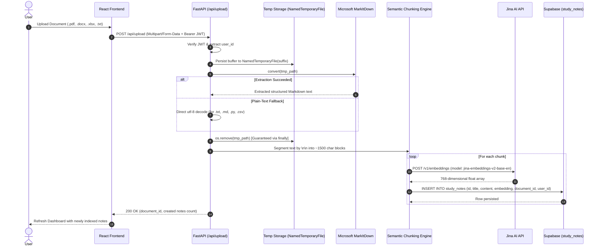
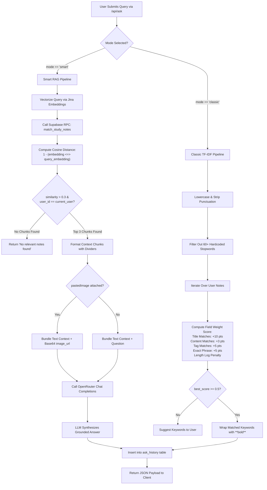

# 🧠 Onlineguru-AI Tutor: Comprehensive System Design Analysis & Interview Preparation Guide

---

## 📑 Table of Contents
1. [Executive Project Overview & Business Value](#1-executive-project-overview--business-value)
2. [End-to-End System Architecture](#2-end-to-end-system-architecture)
   - [High-Level Architecture Diagram](#high-level-architecture-diagram)
   - [Document Ingestion & NLP Parsing Pipeline](#document-ingestion--nlp-parsing-pipeline)
   - [Dual-Engine Query Architecture: Smart RAG vs. Classic TF-IDF](#dual-engine-query-architecture-smart-rag-vs-classic-tf-idf)
   - [Multimodal Vision Reasoning Pipeline](#multimodal-vision-reasoning-pipeline)
   - [Voice Interface & Speech Synthesis Subsystem](#voice-interface--speech-synthesis-subsystem)
   - [Database Schema, RPC, & Vector Math](#database-schema-rpc--vector-math)
   - [Authentication & Multi-Tenant Data Isolation](#authentication--multi-tenant-data-isolation)
   - [Fault Tolerance & Graceful Degradation Strategy](#fault-tolerance--graceful-degradation-strategy)
3. [Deep-Dive Technology Stack Analysis & Rationale](#3-deep-dive-technology-stack-analysis--rationale)
   - [Frontend Architecture (React 19, Vite, Tailwind v4, Framer Motion)](#frontend-architecture)
   - [Backend Architecture (FastAPI, ASGI, Pydantic v2)](#backend-architecture)
   - [AI & Embeddings Tier (Jina AI, OpenRouter, Multimodal LLMs)](#ai--embeddings-tier)
   - [Storage & Vector Tier (Supabase, PostgreSQL, pgvector)](#storage--vector-tier)
4. [Comprehensive Interview Preparation Kit](#4-comprehensive-interview-preparation-kit)
   - [Category A: RAG Architecture, Vector Math & AI Engineering](#category-a-rag-architecture-vector-math--ai-engineering)
   - [Category B: Backend Engineering, FastAPI & Python Concurrency](#category-b-backend-engineering-fastapi--python-concurrency)
   - [Category C: Database Engineering, PostgreSQL & pgvector](#category-c-database-engineering-postgresql--pgvector)
   - [Category D: Frontend Engineering, React 19, Vite & Web APIs](#category-d-frontend-engineering-react-19-vite--web-apis)
   - [Category E: System Design, Scalability & Production Hardening](#category-e-system-design-scalability--production-hardening)
5. [Summary: Elevating Your Project Presentation in an Interview](#5-summary-elevating-your-project-presentation-in-an-interview)

---

## 1. Executive Project Overview & Business Value

### 1.1 Problem Statement
Modern students and knowledge workers face severe cognitive overload when preparing from diverse, multi-format educational materials (textbooks, lecture slides, scanned worksheets, diagrams, and raw code). Generic Large Language Models (LLMs) like base ChatGPT or Claude suffer from two fatal flaws in academic environments:
1. **Hallucination & Fabrication**: Base LLMs extrapolate facts, hallucinate citations, and formulate plausible-sounding falsehoods when asked domain-specific academic questions.
2. **Context Blindness**: They lack access to the student's private, hyper-specific course syllabus, teacher notes, or proprietary curriculum documents.

### 1.2 The Solution: Onlineguru-AI Tutor
**Onlineguru-AI Tutor** is a production-grade, cloud-native educational platform built to provide accurate, grounded, conversational tutoring backed by **Retrieval-Augmented Generation (RAG)**. The platform ingests arbitrary documents (PDF, DOCX, XLSX, TXT, code files), parses visual problem sets via clipboard images, and supports voice-driven Q&A. Every generated answer is mathematically anchored to user-uploaded reference material.

### 1.3 Key Architectural Pillars
- **Zero-Hallucination Grounding**: Retrieval constraints enforce that the LLM answers strictly within retrieved contexts, with fallback warnings when context is insufficient.
- **Dual Retrieval Engines**:
  - *Smart Mode*: 768-dimensional semantic embedding retrieval via Cosine Similarity (`pgvector`).
  - *Classic Mode*: Zero-external-dependency, in-memory TF-IDF scoring with field-weighting (Title > Tags > Content) and keyword highlighting.
- **Multimodal Visual Reasoning**: Direct clipboard image attachment sent to OpenRouter Vision models for diagram analysis and equation decoding.
- **Completely Serverless & Stateless**: Deployed across Vercel Serverless Functions and Supabase Cloud DB with zero persistent local disk state.
- **Resilient Fallback Design**: Dual embedding pipelines (Jina AI direct API $\to$ OpenRouter fallback) and dual storage architectures (Supabase PostgreSQL $\to$ local JSON engine).

---

## 2. End-to-End System Architecture

### High-Level Architecture Diagram



---

### Document Ingestion & NLP Parsing Pipeline



#### Detailed Ingestion Mechanics:
1. **Universal Parsing**: Uses Microsoft's `markitdown` (`0.1.6`) which wraps `pdfminer.six`, OpenXML parsers, and tabular extractors into a single uniform interface.
2. **Deterministic Fallback**: If `markitdown` yields an empty string for plain-text formats (`.txt`, `.csv`, `.json`, `.py`, `.md`), the raw byte buffer is safely decoded using UTF-8 with lenient error replacement (`errors="ignore"`).
3. **Paragraph-Preserving Chunking**: Instead of naive character slicing which cuts words or mathematical expressions in half, the text splits on `\n\n` (natural paragraph boundaries). Paragraphs are accumulated until the chunk size exceeds 1,500 characters.
4. **Context Injection**: Each chunk is prepended with metadata: `Title: <title>\nTags: <tags>\nContent: <chunk>` before being vectorized. This guarantees that semantic queries matching document titles or tags score high similarity even if the specific keyword is absent from the body.

---

### Dual-Engine Query Architecture: Smart RAG vs. Classic TF-IDF

The platform provides a toggle between **Smart AI Mode** (LLM synthesis + Vector search) and **Classic Search Mode** (pure local deterministic keyword search).



#### Mathematical Deep-Dive: Scoring Formula in Classic Mode
The Classic engine utilizes a custom deterministic scoring heuristic that simulates TF-IDF without external dependencies:

$$\text{RawScore}(N) = \sum_{w \in Q_{\text{filtered}}} \left[ 10 \cdot \text{count}(w, N_{\text{title}}) + 3 \cdot \text{count}(w, N_{\text{content}}) + 5 \cdot \text{count}(w, N_{\text{tags}}) + 5 \cdot \mathbb{I}(w \in N_{\text{title}}) \right]$$

To ensure that queries with multiple terms do not artificially blow up scores, and that verbose notes do not dominate over concise summaries:

$$\text{FinalScore}(N) = \left( \frac{\text{RawScore}(N)}{|Q_{\text{filtered}}|} \right) \cdot \left( \frac{\ln(\text{len}(N_{\text{content}}) + 1)}{\ln(\text{len}(N_{\text{content}}) + 10)} \right)$$

---

### Multimodal Vision Reasoning Pipeline

Students frequently study diagrams, circuit schematics, charts, or handwritten math equations that cannot be converted via standard OCR:
1. **Frontend Capture**: The student presses `Ctrl+V` (or clicks the file picker). The browser intercepts the clipboard event via `e.clipboardData.items`.
2. **Data URL Transformation**: The image blob is converted to a base64 `data:image/png;base64,...` string using the HTML5 `FileReader` API.
3. **Payload Construction**: The base64 string is transmitted inside the JSON body of `POST /api/ask`.
4. **OpenRouter Multimodal Dispatch**: The backend constructs an OpenAI-compatible multimodal message object:
   ```json
   {
     "role": "user",
     "content": [
       {"type": "text", "text": "Context:\n...\n\nQuestion: Analyze this graph"},
       {"type": "image_url", "image_url": {"url": "data:image/jpeg;base64,..."}}
     ]
   }
   ```
5. **Model Resolution**: OpenRouter dynamically routes the request to multimodal models (such as `google/gemini-2.0-flash`, `anthropic/claude-3.5-sonnet`, or `openai/gpt-4o`).

---

### Voice Interface & Speech Synthesis Subsystem

The application provides hands-free operation utilizing the native browser **Web Speech API**:
- **Speech-to-Text (STT)**: Uses `window.SpeechRecognition` (or `webkitSpeechRecognition`). Runs in non-continuous mode with `interimResults: true`, instantly reflecting words as the user speaks, and automatically triggers query submission upon final transcription.
- **Text-to-Speech (TTS)**: Uses `window.speechSynthesis` and `SpeechSynthesisUtterance`.
- **Pre-Processing for TTS**: Before passing the LLM's response to the speech engine, markdown tokens (`**`, `#`, backticks) are stripped via regex to prevent the voice synthesizer from pronouncing formatting characters aloud.
- **Voice Preference Fallback**: The client iterates through `window.speechSynthesis.getVoices()` to find high-fidelity natural voices (preferring Google English voices when available).

---

### Database Schema, RPC, & Vector Math

The system uses **PostgreSQL 15+** on Supabase with the **`pgvector`** extension.

```sql
-- 1. Initialize Vector Extension
create extension if not exists vector;

-- 2. Study Notes Table (Stores document chunks and vectors)
create table study_notes (
    id text primary key,
    title text not null,
    content text not null,
    tags text[] default '{}',
    document_id text,
    document_title text,
    user_id text,
    created_at timestamp with time zone default timezone('utc'::text, now()) not null,
    embedding vector(768) -- Jina embeddings v2 dimension
);

-- 3. Ask History Table (Maintains conversational log)
create table ask_history (
    id text primary key,
    question text not null,
    answer text not null,
    asked_at timestamp with time zone default timezone('utc'::text, now()) not null,
    matched_note_id text,
    user_id text
);

-- 4. High-Performance Cosine Similarity Search RPC Function
create or replace function match_study_notes (
  query_embedding vector(768),
  match_threshold float,
  match_count int,
  filter_document_id text default null,
  p_user_id text default null
)
returns table (
  id text,
  title text,
  content text,
  tags text[],
  document_id text,
  document_title text,
  similarity float
)
language plpgsql
as $$
begin
  return query
  select
    study_notes.id,
    study_notes.title,
    study_notes.content,
    study_notes.tags,
    study_notes.document_id,
    study_notes.document_title,
    1 - (study_notes.embedding <=> query_embedding) as similarity
  from study_notes
  where (filter_document_id is null or study_notes.document_id = filter_document_id)
    and (p_user_id is null or study_notes.user_id = p_user_id)
    and study_notes.embedding is not null
    and 1 - (study_notes.embedding <=> query_embedding) > match_threshold
  order by study_notes.embedding <=> query_embedding
  limit match_count;
end;
$$;
```

#### Vector Math Explained:
- `<=>` is the **Cosine Distance** operator in `pgvector`.
- The cosine distance between two vectors $\mathbf{u}$ and $\mathbf{v}$ is:

$$D_C(\mathbf{u}, \mathbf{v}) = 1 - \cos(\theta) = 1 - \frac{\mathbf{u} \cdot \mathbf{v}}{\|\mathbf{u}\| \|\mathbf{v}\|}$$

- Therefore, the **Cosine Similarity** is:

$$\text{Similarity} = 1 - (\mathbf{u} \Leftrightarrow \mathbf{v}) = \cos(\theta)$$

- When vectors are normalized to unit length ($\|\mathbf{u}\| = 1$), cosine distance calculation reduces directly to dot product computation, delivering high indexing throughput.

---

### Authentication & Multi-Tenant Data Isolation

Security and tenant data isolation are enforced at every application layer:
1. **Authentication Provider**: Handled via Supabase Auth (`supabase.auth.sign_up`, `sign_in_with_password`).
2. **Token Passing**: Tokens are transmitted in client HTTP headers via the standard format: `Authorization: Bearer <JWT_ACCESS_TOKEN>`.
3. **Backend Verification (`get_current_user`)**:
   - Uses `PyJWT` to decode the Supabase JWT.
   - Validates the signature against the server's `SUPABASE_JWT_SECRET` with algorithm `HS256` and expected audience `audience="authenticated"`.
   - Extracts the unique user ID (`sub` claim) and email.
   - If invalid or expired, raises `HTTP 401 Unauthorized`.
4. **Row-Level & Query Isolation**: Every database interaction (`get_all_notes`, `search_notes`, `add_note`, `delete_note`, `match_study_notes`, `get_history`) strictly filters queries with `eq("user_id", user_id)`. One user cannot read, search, or vectorize another user's private documents.

---

### Fault Tolerance & Graceful Degradation Strategy

In distributed AI applications, external API outages or rate limits are common. The system employs defensive fallback loops:

| Failure Scenario | Immediate Detection | Automated Fallback / Mitigation |
| :--- | :--- | :--- |
| **Jina AI API Outage / Rate Limit** | HTTP status code $\ne 200$ or timeout > 20s in `get_embedding()` | Catches exception, routes immediately to OpenRouter Embeddings endpoint (`jinaai/jina-embeddings-v2-base-en`). |
| **Supabase Vector DB Outage** | Network timeout or exception in Supabase client | System gracefully defaults to `database._read_db()` (`data/notes.json`) and calculates Cosine Similarity in pure Python using `math.sqrt` and dot products. |
| **Non-Standard Upload File Format** | `markitdown` fails to parse file | Checks file extension against known plain-text extensions (`.txt`, `.py`, `.csv`, `.json`, etc.) and decodes raw binary buffer directly with UTF-8. |
| **Out-of-Domain Question** | Vector search returns similarity $< 0.3$ | System skips the LLM call entirely. Saves API quota and informs user: *"No relevant notes found"*, preventing hallucinated answers. |

---

## 3. Deep-Dive Technology Stack Analysis & Rationale

```
+-----------------------------------------------------------------------------------------+
|                                    TECHNOLOGY STACK                                      |
+-----------------------------------------------------------------------------------------+
| Layer               | Technology               | Version    | Purpose                   |
+---------------------+--------------------------+------------+---------------------------+
| Frontend Framework  | React                    | 19.2.4     | Component SPA UI          |
| Build Tool / Server | Vite                     | 8.0.4      | HMR & Optimized Bundler   |
| Styling System      | TailwindCSS              | 4.2.2      | Utility Styling & Themes  |
| Animation Engine    | Framer Motion            | 12.38.0    | Fluid Transitions         |
| Speech Interface    | Web Speech API           | Native W3C | Speech-to-Text & TTS      |
| Backend Framework   | FastAPI                  | 0.111.0    | High-Perf ASGI REST API   |
| ASGI Web Server     | Uvicorn                  | 0.29.0     | Async Event Loop          |
| Type Validation     | Pydantic                 | 2.7.1      | Request/Response Schemas  |
| Document Parsing    | Microsoft MarkItDown     | 0.1.6      | Multi-Format Parser       |
| PDF Parsing Engine  | pdfminer.six             | 20231228   | PDF Layout & Text         |
| Database & Vectors  | Supabase (PostgreSQL 15) | pgvector   | Relational & Vector Store |
| Embeddings Model    | Jina Embeddings v2       | 768-dim    | 8k Token Context Vectors  |
| LLM Gateway         | OpenRouter API           | Multi-LLM  | Unified API & Vision      |
| Cloud Hosting       | Vercel                   | Serverless | Edge CDN & Serverless API |
+-----------------------------------------------------------------------------------------+
```

### Architectural Decisions & Engineering Rationale

#### 1. Why FastAPI over Django or Flask?
- **Asynchronous Throughput**: FastAPI is natively built on `Starlette` and `uvicorn`, featuring native `async/await` syntax. RAG applications are predominantly I/O-bound (waiting on external embedding APIs, vector database queries, and streaming LLM tokens). Flask blocks synchronous worker threads during network I/O unless paired with complex Celery workers or Gevent.
- **Serverless Cold-Start Performance**: Django includes an ORM, admin panel, template engine, and authentication middleware, resulting in a large memory footprint and 3–5+ second cold starts on serverless platforms. FastAPI initializes in under 300ms on Vercel Serverless.
- **Data Validation & Documentation**: Native Pydantic v2 integration guarantees strict runtime type coercion and auto-generates OpenAPI (`/docs`) schemas without boilerplate.

#### 2. Why React 19 + Vite 8 over Next.js?
- **Decoupled Architecture**: Running Next.js would couple frontend rendering with Node.js server routes. By using Vite for a static Single Page Application (SPA) deployed to Vercel's global CDN and FastAPI for the API, the backend can be independently migrated, scaled, or containerized on platforms like Render or AWS ECS without touching the UI.
- **Build Speeds**: Vite uses native ES modules (`ESM`) and native Go/Rust-based bundlers (`Rolldown` / `esbuild`), achieving instant Hot Module Replacement (HMR) and sub-second rebuilds compared to Webpack-based pipelines.

#### 3. Why Supabase pgvector over Dedicated Vector Databases (Pinecone, Qdrant, Chroma)?
- **Unified Relational & Vector State**: In systems with separate vector databases (e.g., Pinecone), the application suffers from the **Dual-Write Problem**: inserting a note requires writing metadata to Postgres and vector embeddings to Pinecone. If one fails, the databases become desynchronized. With `pgvector`, metadata (`user_id`, `document_id`, `created_at`) and vectors reside in the exact same relational table, providing ACID transactions.
- **Cost Efficiency**: Supabase provides free-tier PostgreSQL with native `pgvector`, whereas standalone managed vector services introduce separate billing tiers.

#### 4. Why Microsoft MarkItDown over LangChain Document Loaders or PyPDF2?
- **Unified Clean Dependency**: Rather than maintaining separate libraries for every file format (`PyPDF2`, `python-docx`, `openpyxl`, `beautifulsoup4`), `markitdown` encapsulates all parsing logic into a unified API (`md.convert(file_path)`).
- **Structural Integrity**: Unlike raw string extractors that discard tables or headers, `markitdown` converts Excel tables and Word headers into formatted GitHub-Flavored Markdown tables. This enables the LLM to retain tabular semantic relationships during RAG synthesis.

---

## 4. Comprehensive Interview Preparation Kit

This interview kit is structured into five distinct engineering domains. Each question includes the **underlying technical concept**, an **in-depth model answer**, potential **interviewer follow-up questions**, and guidance on **how to answer the follow-up**.

---

### Category A: RAG Architecture, Vector Math & AI Engineering

#### Q1: Walk me through the exact lifecycle of a user query in your RAG pipeline from input to response synthesis.
- **Concept Tested**: End-to-end RAG comprehension, prompt engineering, vector search latency, and LLM orchestration.
- **Model Answer**:
  > *"When a user submits a query in Smart Mode, the request hits the FastAPI endpoint `/api/ask` along with a Bearer JWT. The backend first extracts the authenticated `user_id`. The raw query string is transmitted to the Jina AI embeddings API (`jina-embeddings-v2-base-en`) to compute a 768-dimensional dense vector representing the question's semantic intent.
  > 
  > Next, this vector is passed to our Supabase PostgreSQL database via the stored procedure `match_study_notes`. The database executes a Cosine Similarity search (`1 - (study_notes.embedding <=> query_embedding)`) filtered strictly by the user's ID and an optional `document_id`. We apply a similarity threshold of 0.3 and retrieve the top 3 highest-ranking text chunks.
  > 
  > If no chunks exceed 0.3, the system short-circuits and immediately returns a fallback message, bypassing the LLM to prevent hallucinations and save API costs. If chunks are found, they are combined with title and tag metadata and formatted into an augmented context block separated by markdown dividers. 
  > 
  > This context is injected into a system prompt instructing the model to act as the 'Onlineguru-AI tutor' and answer strictly using the provided context. Finally, we call OpenRouter with a low temperature of 0.3 to ensure deterministic, factual output, record the question and response in `ask_history`, and return the JSON response to the client."*
- **Follow-up Question**: *"Why did you set the temperature to 0.3 instead of 0.0 or 0.7, and what happens if the user's query requires multi-hop reasoning across chunks?"*
- **How to Answer Follow-up**:
  > Explain that a temperature of 0.0 is completely greedy/argmax decoding, which can sometimes produce repetitive or robotic prose in conversational tutoring. Setting it to 0.3 allows slight lexical variety for natural phrasing while keeping factual entropy very low. For multi-hop reasoning, acknowledge that standard top-$k$ single-query vector retrieval can struggle if the answer requires connecting disparate clues across non-contiguous chunks; to solve this, mention techniques like reciprocal rank fusion (RRF), sub-query generation, or agentic query rewriting.

---

#### Q2: What is the mathematical difference between Cosine Distance and Euclidean (L2) Distance, and why is Cosine Distance standard for semantic embeddings?
- **Concept Tested**: Vector geometry, normalization, metric spaces, and embedding space dynamics.
- **Model Answer**:
  > *"Euclidean Distance ($L_2$) measures the straight-line geometrical distance between the tips of two vectors in $n$-dimensional space:*
  > 
  > $$D_{L_2}(\mathbf{u}, \mathbf{v}) = \sqrt{\sum_{i=1}^{n} (u_i - v_i)^2}$$
  > 
  > *Cosine Distance, on the other hand, measures the angle between the two vectors regardless of their magnitudes:*
  > 
  > $$D_{\text{Cosine}}(\mathbf{u}, \mathbf{v}) = 1 - \frac{\mathbf{u} \cdot \mathbf{v}}{\|\mathbf{u}\|_2 \|\mathbf{v}\|_2}$$
  > 
  > *In natural language processing and semantic embeddings, document length often dictates vector magnitude (norm). A short 10-word summary and an exhaustive 300-word paragraph discussing the identical concept will point in nearly the exact same directional trajectory in the semantic latent space, but their vector magnitudes will differ significantly. Euclidean distance would penalize this difference in magnitude and incorrectly classify them as distant, whereas Cosine Distance evaluates the angle $\theta$, correctly recognizing high semantic similarity."*
- **Follow-up Question**: *"What happens if all your vectors are unit-normalized before indexing in `pgvector`?"*
- **How to Answer Follow-up**:
  > Note that when vectors are $L_2$-normalized such that $\|\mathbf{u}\|_2 = 1$, Cosine Distance simplifies directly to $1 - (\mathbf{u} \cdot \mathbf{v})$ (one minus the inner product). This allows the vector search to use the Inner Product operator (`<#>`), which is computationally cheaper than computing magnitudes on the fly during vector scans.

---

#### Q3: How did you implement chunking, why is paragraph-based chunking superior to fixed-character slicing, and what are its trade-offs?
- **Concept Tested**: Document preprocessing, token economics, context window management, and semantic boundary preservation.
- **Model Answer**:
  > *"In our ingestion pipeline (`main.py`), we split documents on double newlines (`\n\n`) to identify natural paragraph boundaries. We then accumulate paragraphs until reaching approximately 1,500 characters (~300–400 tokens) before creating a new chunk.
  > 
  > Naive fixed-size slicing (e.g., cutting every 1,000 characters) frequently splits the text mid-sentence, separates mathematical formulas from their variable definitions, or severs a question from its answer. By respecting paragraph breaks, each chunk retains its localized semantic coherence.
  > 
  > However, the trade-off is chunk size variability. If an uploaded document contains a massive monolithic paragraph with no double-breaks (such as unformatted OCR output or raw logs), our paragraph-accumulator could create a chunk that exceeds optimal embedding boundaries. To handle this edge case, we implemented a fallback size-slicer that activates if no paragraph chunks are successfully resolved."*
- **Follow-up Question**: *"How would you enhance this chunking strategy for complex documents with tables or hierarchical code?"*
- **How to Answer Follow-up**:
  > Propose **hierarchical or parent-document retrieval**. In this design, small child chunks (e.g., 200 characters) are embedded for precise vector matching, but once matched, the parent section (e.g., 2,000 characters) is passed to the LLM. For tables, mention that `markitdown` outputs Markdown table syntax, which is preserved as an atomic block so column-row alignments remain intact.

---

#### Q4: How does your multimodal vision pipeline process image queries, and what are the security and bandwidth implications of Base64 encoding?
- **Concept Tested**: Multimodal LLM integration, MIME handling, base64 payload overhead, and API rate limits.
- **Model Answer**:
  > *"In our frontend (`AskAI.jsx`), we capture clipboard paste events (`onPaste`) or file uploads. The browser converts the image `File` object into a Base64 data URL using the HTML5 `FileReader` API (`readAsDataURL`). This string is passed in the JSON payload of the `/api/ask` POST request.
  > 
  > In `rag_engine.py`, when `image_data` is present, the message content sent to OpenRouter is structured as a multipart list of dictionaries: one item with type `text` containing the retrieved document context and the question, and the other with type `image_url` containing the Base64 data string.
  > 
  > The primary trade-off of Base64 is bandwidth overhead: Base64 encoding converts 3 bytes of binary data into 4 ASCII characters, resulting in a ~33% inflation in payload size. For high-resolution files, this increases network transfer latency and backend memory consumption. In an enterprise production refactor, I would upload the image to an object store like AWS S3 or Supabase Storage, obtain a pre-signed ephemeral URL, and send that URL to the vision model instead."*
- **Follow-up Question**: *"How do you combine textual RAG retrieval with image queries if the question is ambiguous (e.g., 'Explain step 2 in this diagram')?"*
- **How to Answer Follow-up**:
  > Explain that the query vector for 'Explain step 2 in this diagram' will attempt to search textual notes for 'diagram' or 'step 2', which may have low relevance on its own. To improve this, you can implement a two-step agentic pipeline: first, ask a fast vision model to generate a dense caption/OCR transcription of the image, combine that description with the user's question, and use the enriched text to perform the vector search against the knowledge base.

---

### Category B: Backend Engineering, FastAPI & Python Concurrency

#### Q5: Why did you choose FastAPI over Flask or Django for this project, and how does its ASGI architecture handle concurrent I/O requests?
- **Concept Tested**: WSGI vs. ASGI, Python event loops, asynchronous programming, and microframework trade-offs.
- **Model Answer**:
  > *"FastAPI was selected for three core reasons: native asynchronous I/O, serverless performance, and automated schema validation.
  > 
  > Traditional frameworks like Flask and Django (historically) run on the WSGI specification, which is synchronous and relies on a thread-per-request model. In our application, requests spend the vast majority of their time in I/O wait states: waiting 500ms to 2000ms for OpenRouter to complete LLM synthesis, or waiting on network round-trips to Supabase. Under a synchronous WSGI server like standard Gunicorn, worker threads quickly become exhausted under moderate concurrent traffic unless a large pool of threads is maintained.
  > 
  > FastAPI runs on ASGI (via `uvicorn`), utilizing Python's `asyncio` event loop. When an asynchronous endpoint awaits an external I/O call, the worker does not block; it yields control back to the event loop, which immediately processes the next incoming HTTP request on the same thread. Furthermore, FastAPI's tight coupling with Pydantic ensures runtime request validation with compile-time type hints and auto-generates Swagger/OpenAPI documentation."*
- **Follow-up Question**: *"In your codebase, I noticed some endpoints are defined with `def` instead of `async def`. What does FastAPI do under the hood when you define a synchronous route?"*
- **How to Answer Follow-up**:
  > Explain that when an endpoint is declared as a plain `def` (synchronous), FastAPI automatically offloads its execution to an external thread pool (using `anyio.to_thread.run_sync`) rather than executing it directly on the main event loop. This prevents slow synchronous code (such as file I/O or CPU-bound loops) from blocking the event loop. In contrast, routes declared as `async def` run directly on the main event loop thread, meaning any blocking synchronous call inside them will stall the entire server.

---

#### Q6: How does the FastAPI `lifespan` handler work in your codebase, and why did you disable mass note synchronization on serverless cold starts?
- **Concept Tested**: Application lifecycle management, serverless runtime constraints, and cold-start optimization.
- **Model Answer**:
  > *"FastAPI provides the `lifespan` async context manager to execute logic before the application starts accepting requests and right before it shuts down. In our codebase (`main.py`):
  > 
  > ```python
  > @asynccontextmanager
  > async def lifespan(app: FastAPI):
  >     # Server setup
  >     yield
  >     # Server cleanup
  > ```
  > 
  > Originally, during local prototyping, the lifespan handler fetched all notes from SQLite/JSON and generated embeddings to populate a local ChromaDB instance on startup. However, when we migrated the application to Vercel Serverless Functions, this pattern became an anti-pattern. 
  > 
  > Serverless environments are stateless and ephemeral; container instances spin up on demand and spin down after short periods of inactivity. If every cold start re-embedded hundreds of notes, request latency would spike to tens of seconds, external API quotas would be exhausted immediately, and Vercel's execution timeout (10–15 seconds) would be breached. Therefore, we moved vector persistence entirely into Supabase `pgvector` and disabled mass startup syncing, ensuring instant cold starts."*
- **Follow-up Question**: *"How do you handle background tasks or scheduled jobs in a serverless FastAPI architecture?"*
- **How to Answer Follow-up**:
  > Point out that in a serverless environment (like Vercel), you cannot rely on in-memory background threads (like `BackgroundTasks` or long-running Celery workers) because the execution environment can freeze immediately after the HTTP response is delivered. Instead, background work should be dispatched to an external queue (e.g., AWS SQS, Celery with Redis, or Upstash QStash) and consumed by dedicated worker instances or triggered via webhooks.

---

#### Q7: How does your system extract text from diverse document formats without depending on separate libraries for each extension?
- **Concept Tested**: File parsing abstraction, temporary file lifecycles, and exception handling.
- **Model Answer**:
  > *"We integrated Microsoft's `markitdown` library in our `/api/upload` endpoint. Instead of writing custom logic for PDFs (`pdfminer`), Word docs (`python-docx`), and Excel spreadsheets (`openpyxl`), `markitdown` acts as a unified abstraction layer that inspects the file stream and converts structured data into Markdown.
  > 
  > In serverless architectures, there is no persistent local file system, but ephemeral write access is available in `/tmp`. In `main.py`, we receive the binary file via FastAPI's `UploadFile`, write it to a `tempfile.NamedTemporaryFile`, pass the temporary file path to `md.convert()`, extract the Markdown string, and clean up the file inside a `finally` block using `os.remove()` to prevent disk exhaustion.
  > 
  > If `markitdown` fails or produces an empty string on raw text files (e.g., `.txt`, `.py`, `.json`, `.csv`), we intercept this with a secondary fallback layer that decodes the raw bytes directly using UTF-8 with `errors='ignore'`."*
- **Follow-up Question**: *"What happens if a user uploads a password-protected PDF or a corrupted 100MB file? How would you protect the server?"*
- **How to Answer Follow-up**:
  > Detail three defense layers:
  > 1. **File Size Capping**: Check `Content-Length` headers and inspect chunked streaming reads to reject files exceeding a threshold (e.g., 10MB) before spooling the full payload into memory.
  > 2. **Magic Byte Verification**: Check binary file signatures (magic bytes via `python-magic`) rather than trusting user-provided file extensions.
  > 3. **Defensive Error Handling**: Wrap parser calls in specific exception blocks (`pdfminer.pdfparser.PDFPasswordException`) and return a clean 400 Bad Request with a clear message: *"File is password-protected"*.

---

### Category C: Database Engineering, PostgreSQL & pgvector

#### Q8: How does the `match_study_notes` stored procedure in Supabase work, and why execute similarity matching inside PostgreSQL rather than in Python?
- **Concept Tested**: In-database computation, network data transfer reduction, and SQL stored procedures.
- **Model Answer**:
  > *"The `match_study_notes` function is a PL/pgSQL stored procedure deployed directly inside PostgreSQL. It accepts the 768-dimensional query vector, a similarity threshold, a top-$k$ match count, an optional document filter ID, and a user ID:
  > 
  > ```sql
  > 1 - (study_notes.embedding <=> query_embedding) as similarity
  > ```
  > 
  > Performing this calculation inside the database is fundamentally superior to pulling vectors into Python for two reasons:
  > 1. **Network I/O & Bandwidth**: If an application has 100,000 note chunks, each with a 768-dimensional float vector (approximately 3KB per vector), transferring all vectors to the Python backend would require streaming ~300MB of data over the network for every single user question.
  > 2. **Index Optimization**: Running inside PostgreSQL allows the database engine to utilize native vector index structures (like HNSW or IVFFlat) to prune the search space from $O(N)$ linear scans down to logarithmic or sub-linear approximate nearest neighbor queries, returning only the top 3 small text rows across the network wire."*
- **Follow-up Question**: *"What is the difference between HNSW and IVFFlat index types in `pgvector`, and which would you choose as your database scales?"*
- **How to Answer Follow-up**:
  > - **IVFFlat (Inverted File Flat)**: Partitions the vector space into Voronoi cells/clusters. During a query, it only scans vectors within the closest centroids. It is faster to build and consumes less memory, but requires data to be present before training centroids, and search recall can drop as new vectors are added without rebuilding the index.
  > - **HNSW (Hierarchical Navigable Small World)**: Builds a multi-layered graph where the bottom layer contains all vectors and higher layers contain sparser skip-lists. It provides significantly faster search queries and higher recall with dynamic inserts, at the cost of higher RAM usage and slower index build times.
  > - *Conclusion*: For high-concurrency production RAG systems with frequent document uploads, **HNSW** is generally preferred.

---

#### Q9: How is multi-tenancy and data isolation enforced in your database design?
- **Concept Tested**: Multi-tenant architectures, SQL injection prevention, and authorization boundaries.
- **Model Answer**:
  > *"Every entry in the `study_notes` and `ask_history` tables contains a mandatory `user_id` text column populated from the verified Supabase JWT (`sub` claim). 
  > 
  > In our backend data layer (`database.py`), all query operations explicitly apply equality filters on `user_id`. For example:
  > 
  > ```python
  > supabase.table("study_notes").select("*").eq("user_id", user_id)
  > ```
  > 
  > Furthermore, the stored procedure `match_study_notes` enforces this at the SQL layer with the predicate:
  > 
  > ```sql
  > where (p_user_id is null or study_notes.user_id = p_user_id)
  > ```
  > 
  > To ensure ironclad multi-tenancy in production, PostgreSQL **Row-Level Security (RLS)** policies can be enabled in Supabase, using `auth.uid() = user_id`. This guarantees that even if an application bug omitted the filter in Python, the database engine itself would enforce that no user can query or delete records belonging to another tenant."*
- **Follow-up Question**: *"Why did you implement a local JSON fallback in `database.py`, and how does it execute vector math without pgvector?"*
- **How to Answer Follow-up**:
  > Highlight your focus on system resilience. If the Supabase cloud connection drops, the system falls back to `data/notes.json`. In this fallback mode, vector similarity is computed using a pure Python implementation of Cosine Similarity:
  > 
  > $$\text{Cosine Similarity} = \frac{\sum_{i} a_i b_i}{\sqrt{\sum_i a_i^2} \sqrt{\sum_i b_i^2}}$$
  > 
  > It computes the dot product and Euclidean norms using Python's `math.sqrt`, sorts the matches, and returns the top-$k$ chunks. While this is an $O(N)$ operation suited only for local development or emergency fallbacks, it ensures the application remains functional even during cloud outages.

---

### Category D: Frontend Engineering, React 19, Vite & Web APIs

#### Q10: How does the authentication flow operate between React, localStorage, and FastAPI?
- **Concept Tested**: Token-based authentication, React Context API, protected routes, and state persistence.
- **Model Answer**:
  > *"We utilize Supabase GoTrue Auth orchestrated through our `AuthContext.jsx` provider:
  > 1. When a user submits credentials on `/login`, the frontend calls `api.auth.login(email, password)` which hits FastAPI's `/api/auth/login`.
  > 2. FastAPI proxies the authentication to Supabase, which returns a session containing an `access_token` (JWT) and user metadata.
  > 3. The React client stores the JWT in `localStorage` under `auth_token` and updates the React state.
  > 4. In `api.js`, every outgoing `fetch` request intercepts and appends the header: `Authorization: Bearer ${token}`.
  > 5. Route protection is enforced via a `<ProtectedRoute>` wrapper in `App.jsx`. If `isAuthenticated` evaluates to false, the user is redirected to `/login` via React Router DOM v7."*
- **Follow-up Question**: *"What are the security vulnerabilities associated with storing JWTs in `localStorage`, and how would you mitigate them in high-security environments?"*
- **How to Answer Follow-up**:
  > Explain that storing tokens in `localStorage` leaves them accessible to JavaScript, making them vulnerable to **Cross-Site Scripting (XSS)** attacks if a malicious script runs on the page. In high-security environments, tokens should be stored in **`HttpOnly`, `Secure`, `SameSite=Strict` cookies**, which browsers block JavaScript from reading. Paired with anti-CSRF tokens, this protects against both XSS token exfiltration and Cross-Site Request Forgery.

---

#### Q11: How did you implement voice interaction in the frontend, and how do you handle cross-browser compatibility?
- **Concept Tested**: Browser Web APIs, event listeners, speech synthesis lifecycle, and feature detection.
- **Model Answer**:
  > *"We created a custom React hook `useVoice.js` that wraps the native W3C **Web Speech API**:
  > - **Speech Recognition (STT)**: We inspect `window.SpeechRecognition || window.webkitSpeechRecognition`. If neither exists, `isSupported` is set to false and the microphone UI is disabled gracefully. We configure `continuous: false` and `interimResults: true`. As the student speaks, intermediate transcription events update the text input in real-time. When `event.results[0].isFinal` triggers, we automatically submit the question.
  > - **Speech Synthesis (TTS)**: When an answer arrives, the user can click the speaker button. We instantiate a `SpeechSynthesisUtterance`, strip markdown formatting (`**`, `#`, backticks) using regex so formatting characters aren't read aloud, search `window.speechSynthesis.getVoices()` for preferred English natural voices, and call `window.speechSynthesis.speak()`."*
- **Follow-up Question**: *"Mobile browsers often restrict audio playback unless triggered by user interaction. How does your voice implementation handle this?"*
- **How to Answer Follow-up**:
  > Mention that mobile browsers (iOS Safari, Android Chrome) block automated programmatic audio execution until a direct user gesture (like a tap or click) occurs. In our UI, `speak()` is only called in direct response to the user clicking the sound button on the `AnswerCard`, fulfilling browser autoplay security policies.

---

### Category E: System Design, Scalability & Production Hardening

#### Q12: If this platform grew from 100 users to 100,000 active students uploading large textbooks, where would the architectural bottlenecks emerge, and how would you redesign it?
- **Concept Tested**: High-level system design, horizontal scaling, asynchronous queues, caching, and database sharding.
- **Model Answer**:
  > *"At 100,000 active students, three immediate bottlenecks would emerge:
  > 
  > 1. **Serverless Upload Timeouts**: Large 500-page textbooks take 30+ seconds to parse and generate embeddings for hundreds of chunks. Vercel serverless functions have hard execution timeouts (10–60s) and will terminate mid-upload.
  >    - *Redesign*: Decouple ingestion into an asynchronous event-driven pipeline. The frontend uploads the file directly to S3/Supabase Storage via pre-signed URLs. An S3 `ObjectCreated` event triggers a background worker (via Celery, Redis Queue, or AWS Lambda) that chunks, embeds, and indexes the document asynchronously, notifying the user via WebSockets or push notifications upon completion.
  > 
  > 2. **Embedding & Vector Search Latency**: Linear scans in `pgvector` without indexing would degrade database CPU performance.
  >    - *Redesign*: Build **HNSW** indexes on the `study_notes` embedding column. Introduce a Redis semantic cache: if multiple students in the same class ask the exact same question, we return the cached response rather than re-computing embeddings and calling the LLM.
  > 
  > 3. **LLM Cost & Rate Limits**: 100k students querying OpenRouter concurrently would breach rate limits and incur high token costs.
  >    - *Redesign*: Implement local inference options (e.g., self-hosted vLLM or Ollama instances with quantized open-weights models like Llama 3 or Mistral) for common queries, reserving proprietary cloud models for complex reasoning."*
- **Follow-up Question**: *"How would you design the Semantic Cache you just mentioned?"*
- **How to Answer Follow-up**:
  > Explain that a Semantic Cache does not rely on exact string equality. Instead, it embeds the incoming question and performs a fast similarity check against a cache of previously asked questions (stored in Redis or an in-memory vector index). If an existing question has a similarity score $> 0.96$, the cached answer is returned immediately, reducing response time from ~2000ms to <50ms and saving LLM costs.

---

## 5. Summary: Elevating Your Project Presentation in an Interview

When discussing this project with hiring managers and technical interviewers, frame the conversation around **trade-offs, engineering decisions, and resilience**, rather than simply listing libraries:

1. **Highlight Engineering Trade-offs**: Emphasize *why* you chose `pgvector` over Pinecone (relational ACID cohesion + no dual-write problem), and *why* you chose FastAPI over Django (serverless startup speed + async I/O efficiency).
2. **Emphasize Defensive Engineering**: Point out that you did not rely solely on happy paths; discuss your dual embedding fallback (Jina AI $\to$ OpenRouter) and dual storage architecture (Supabase $\to$ local JSON engine).
3. **Demonstrate AI Systems Maturity**: Explain that building a RAG application is not just about connecting an API. It involves token optimization, semantic preservation during chunking, context injection (Title + Tags), threshold filtering to prevent hallucinations, and deterministic temperature tuning.
4. **Articulate Future Scalability**: Show that you understand how this system would evolve from a prototype into an enterprise product through asynchronous ingestion queues, HNSW vector indexing, and semantic response caching.

